# NetworkWalks Week 2: Footprinting & Network Scanning

**Author:** Khamis Mussa Khamis
**Programme:** NetworkWalks Cybersecurity & Ethical Hacking, Week 2 Project Work
**Environment:** Kali Linux (VirtualBox) and Windows 11
**Purpose:** Education only

---

## 1. Summary

This repository contains my Week 2 project work and the final report (W2-PM-FINAL). Week 2 is about **footprinting and reconnaissance**: collecting as much public information as possible about a target *before* any attack is attempted, then scanning a network to see which machines are alive.

I completed **one elective group and both essential modules**, plus this report:

| Module | Title | Type | Status |
|---|---|---|---|
| W2-PM1 | Footprinting with multiple Kali tools | Elective | Done (6 tasks) |
| W2-PM3 | Footprinting with Maltego | Elective | Done (2 tasks) |
| W2-PM4 | Footprinting with theHarvester | Elective | Done (2 tasks) |
| W2-PM5 | Network scanning with Zenmap | Essential | Done (see notes in section 7) |
| W2-PM-FINAL | Detailed report | Essential | This document |

I did not do W2-PM2 (GHDB). This report covers only the modules listed above.

## 2. Scope and rules I followed

- The targets were the ones given in the course tasks: `networkwalks.com` (PM1, PM3) and `microsoft.com` (PM4).
- Only passive or low-impact queries were used (WHOIS, DNS lookups, a single HTTP header request, search-engine and OSINT sources). No exploitation, brute forcing or denial-of-service was attempted.
- The Zenmap scan (PM5) was run only against my own lab network.
- Nothing in this repository should be used against systems you do not own or do not have written permission to test.

## 3. Repository structure

```
.
├── README.md                      <- this report
├── PM1-multiple-kali-tools/       <- screenshots + raw text output of each command
├── PM3-maltego/
├── PM4-theharvester/
└── PM5-zenmap/
```

---

## 4. W2-PM1: Footprinting with multiple Kali tools

**Target:** `networkwalks.com`
**Date of tests:** 11 Nov 2026

### Task 1: WHOIS (domain registration details)

Command: `whois networkwalks.com`

| Item | Result |
|---|---|
| Registrar | GoDaddy.com, LLC |
| Created | 2019-11-06 |
| Last updated | 2025-11-12 |
| Expires | 2027-11-06 |
| Name servers | NS6135.HOSTGATOR.COM, NS6136.HOSTGATOR.COM |
| DNSSEC | unsigned |
| Status | client delete/renew/transfer/update prohibited (registrar lock is on) |

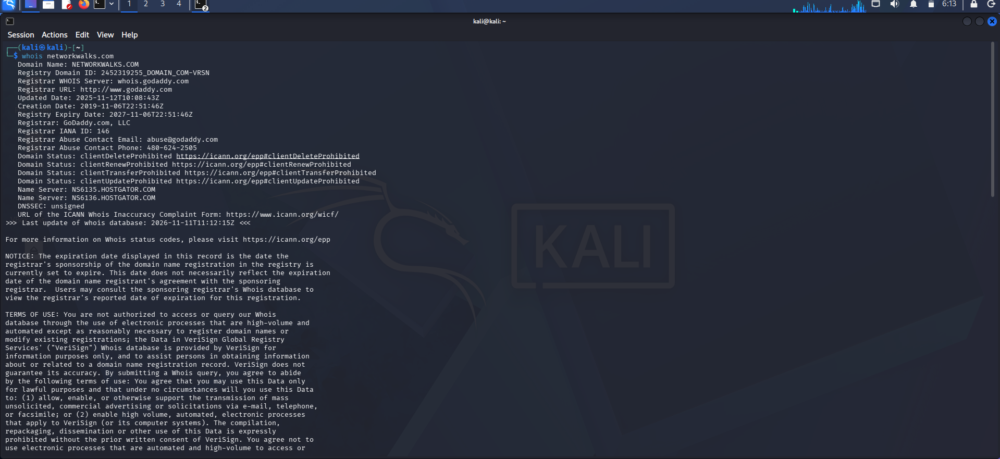

Raw output: [task1-whois.txt](PM1-multiple-kali-tools/task1-whois.txt)

**What it tells an attacker:** who owns and hosts the domain, how old it is, and which name servers to look at next.

### Task 2: WhatWeb (web technology fingerprint)

Command: `whatweb networkwalks.com`

- `http://` redirects (301) to `https://`, which answers `200 OK`.
- Web server: **Apache**.
- CMS: **WordPress**, with a WordPress Download Manager cookie (`__wpdm_client`).
- Other technologies: Bootstrap, jQuery 3.7.1, HTML5, Google Tag Manager.
- IP address: `192.232.216.135` (United States).
- A public contact email, `info@networkwalks.com`, was found in the page.

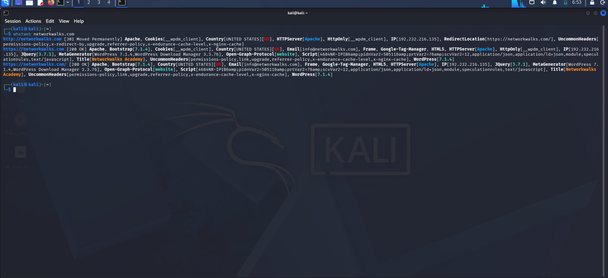

Raw output: [task2-whatweb.txt](PM1-multiple-kali-tools/task2-whatweb.txt)

**What it tells an attacker:** because the site is WordPress, WordPress-specific weaknesses (outdated plugins and themes, weak logins) become the first things to check.

### Task 3: nslookup (domain to IP)

Command: `nslookup networkwalks.com`

- The query was answered by my local DNS server `192.168.10.254`.
- `networkwalks.com` resolves to **192.232.216.135** (non-authoritative answer).

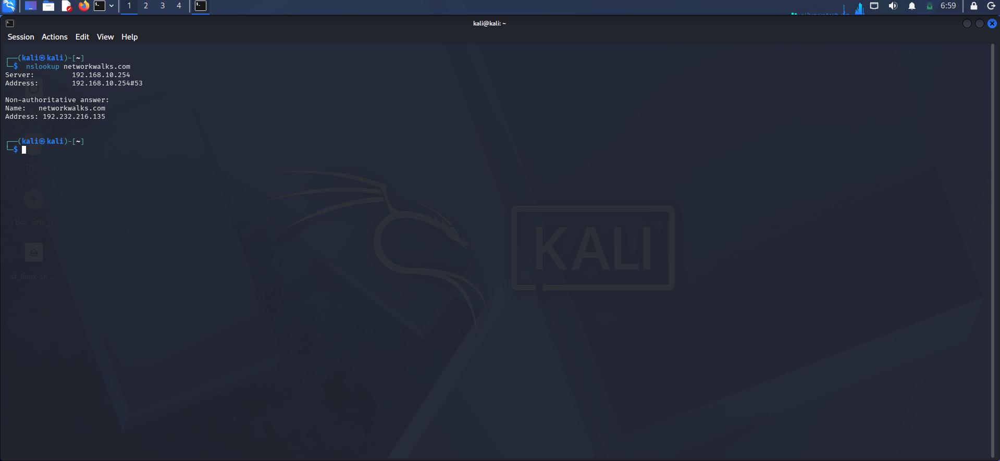

Raw output: [task3-nslookup.txt](PM1-multiple-kali-tools/task3-nslookup.txt)

### Task 4: curl -I (HTTP response headers)

Command: `curl -I https://networkwalks.com`

- Response: `HTTP/2 200`.
- `server: Apache`.
- `x-nginx-cache: WordPress` shows a caching layer in front of WordPress.
- A `link` header points to `/wp-json/`, which confirms the WordPress REST API.
- A `permissions-policy` header and `referrer-policy: no-referrer-when-downgrade` are set.
- A `__wpdm_client` cookie is issued with the `secure` and `HttpOnly` flags.

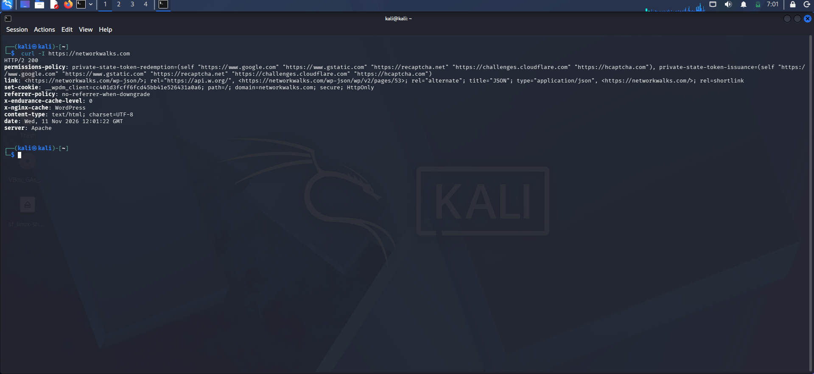

Raw output: [task4-curl-headers.txt](PM1-multiple-kali-tools/task4-curl-headers.txt)

**What it tells an attacker:** headers leak the server software and platform without needing to touch the application itself.

### Task 5: wafw00f (Web Application Firewall detection)

Command: `wafw00f networkwalks.com`

- Result: the site is behind a **ModSecurity (SpiderLabs) WAF**, detected with 2 requests.

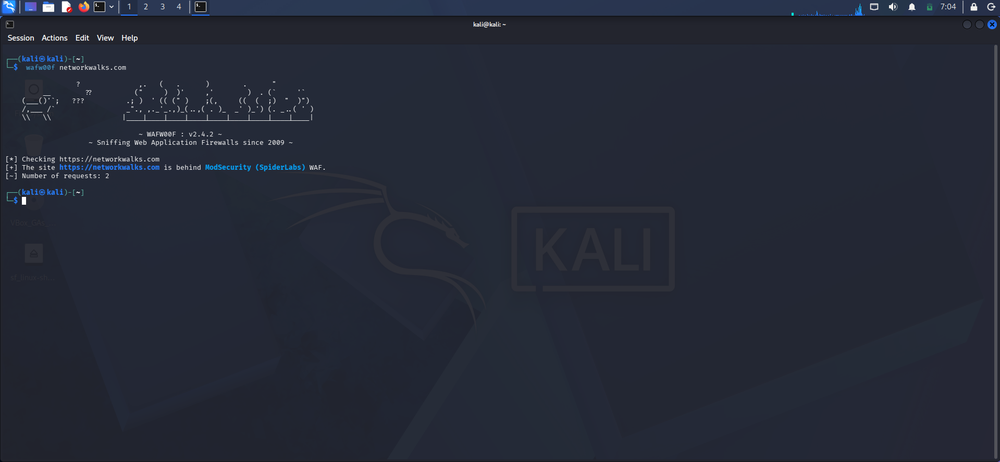

Raw output: [task5-wafw00f.txt](PM1-multiple-kali-tools/task5-wafw00f.txt)

**What it tells an attacker:** a WAF will block or filter many simple attacks, so an attacker needs to plan around it. For a defender, this is a good sign.

### Task 6: dnsrecon (DNS enumeration)

Command: `dnsrecon -d networkwalks.com`

| Record | Value |
|---|---|
| SOA | ns6135.hostgator.com (50.87.144.87) |
| NS | ns6136.hostgator.com (192.232.216.131), ns6135.hostgator.com (50.87.144.87) |
| MX | mail.networkwalks.com (192.232.216.135) |
| A | networkwalks.com (192.232.216.135) |
| TXT | SPF record (`v=spf1 +a +mx +ip4:50.87.144.87 +include:websitewelcome.com ~all`) and a Google site verification record |
| SRV | 8 `_autodiscover._tcp` records pointing to `cpanelemaildiscovery.cpanel.net` |

- 8 records were found in total.
- DNSSEC did not answer (consistent with "unsigned" in the WHOIS output).
- The name servers reported BIND version `9.16.23-RH`.

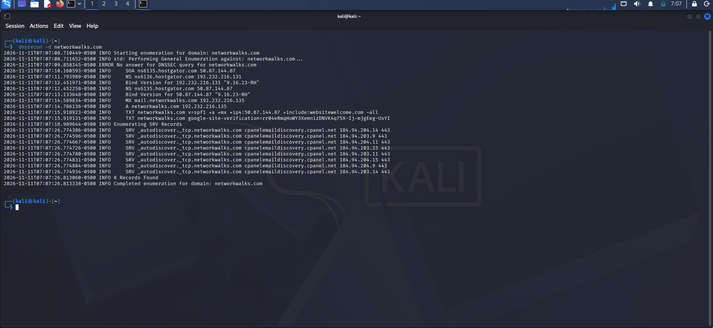

Raw output: [task6-dnsrecon.txt](PM1-multiple-kali-tools/task6-dnsrecon.txt)

**What it tells an attacker:** the mail server, the mail setup (cPanel) and the DNS software version, which can be matched against known vulnerabilities.

---

## 5. W2-PM3: Footprinting with Maltego

**Tool:** Maltego Desktop 4.14.0 (free account) on Windows
**Target:** `networkwalks.com`

### Task 1: Install Maltego on Windows

I downloaded Maltego from the official site, installed it, created a free Maltego ID, and signed in. Maltego opened with a blank graph and was ready to run transforms.

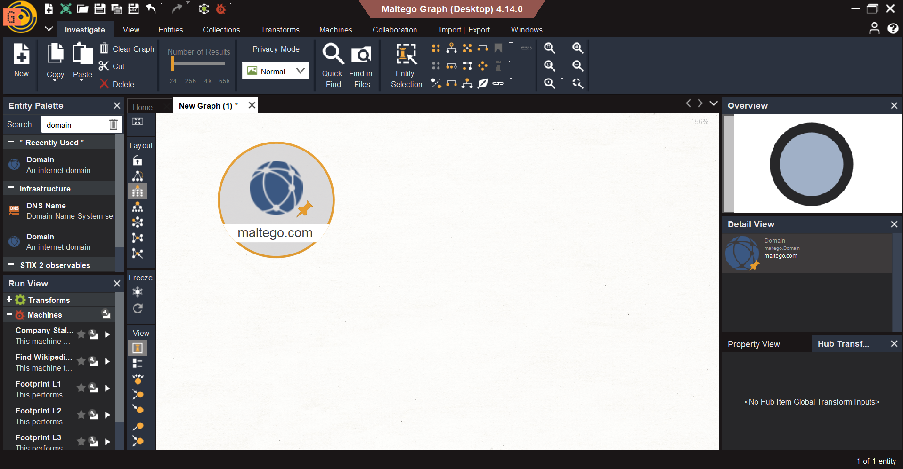

### Task 2: Find email addresses for the domain

Steps:

1. Searched the Entity Palette for **Domain** and dragged it onto the graph.
2. Renamed the entity to `networkwalks.com`.
3. Right-clicked the entity and filtered the transforms by "email".
4. Ran the transform **[Utilities] To Emails @domain [Search Engine]**.

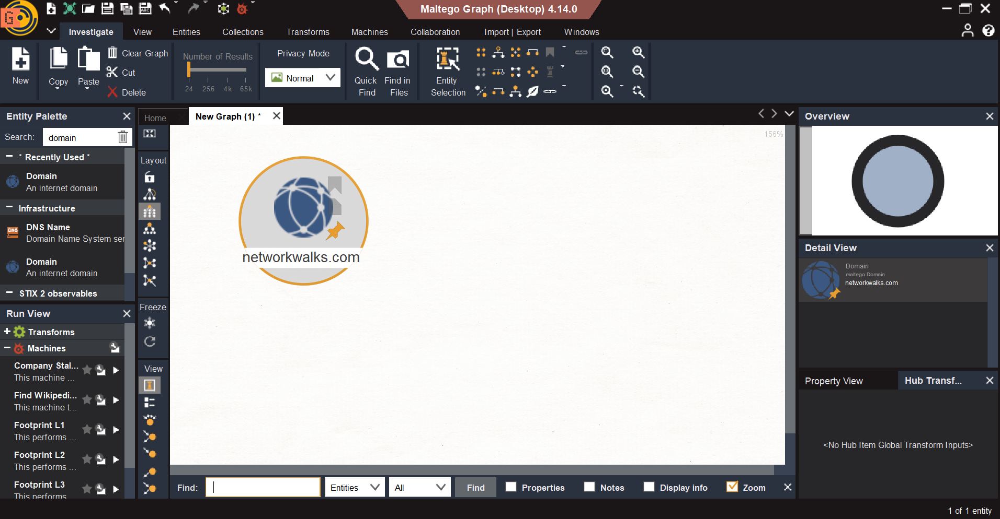

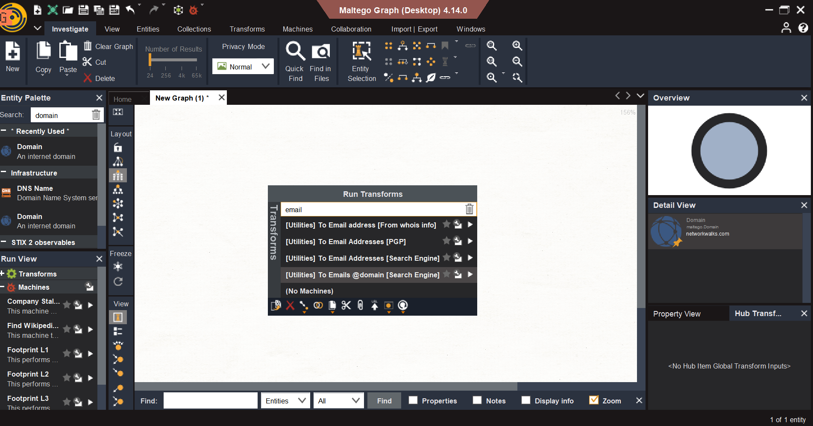

**Result:** one email address was found: **info@networkwalks.com**. The transform completed in about 19 seconds.

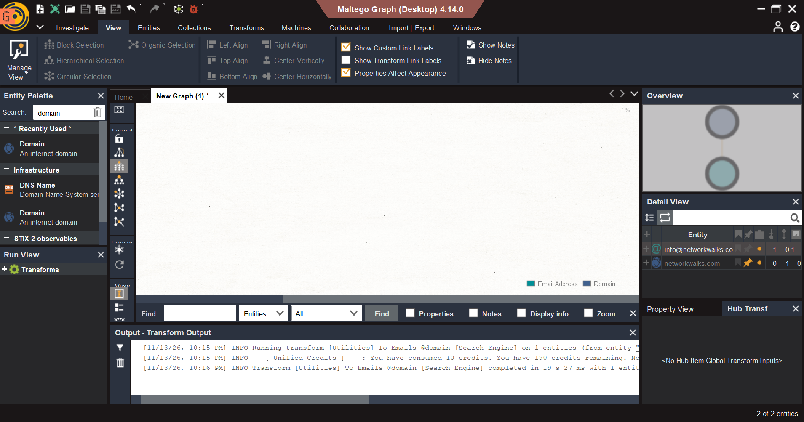

**What it tells an attacker:** email addresses are the starting point for phishing and for guessing usernames.

---

## 6. W2-PM4: Footprinting with theHarvester

**Tool:** theHarvester 4.11.1 on Kali Linux
**Target:** `microsoft.com`

### Task 1: Baidu, limit 1000

I first read the help text (`theHarvester -h`) to see the options and supported sources, then ran:

```
theHarvester -d microsoft.com -l 1000 -b baidu
```

`-d` is the target domain, `-l` limits the number of results, and `-b` chooses the data source.

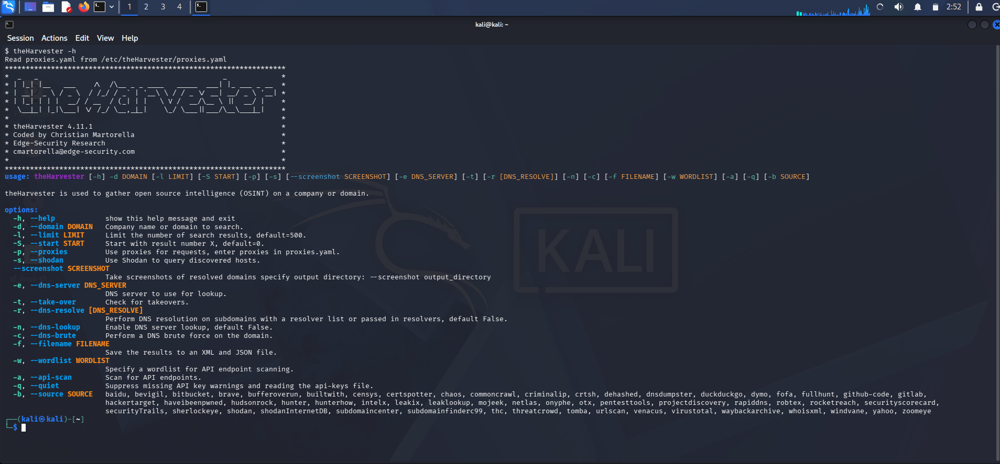

**Result:** Baidu returned **no IPs, no emails, no people and no hosts** for this search. The course notes that results change over time because they depend on third-party sources, so an empty result is possible.

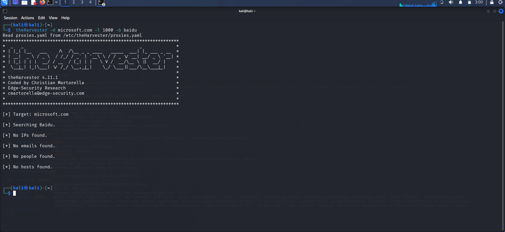

### Task 2: all sources, limit 50

```
theHarvester -d microsoft.com -l 50 -b all
```

**Result:** theHarvester tried many sources at once. Several of them (for example BeVigil, Bitbucket, BuiltWith, Brave Search, Censys, CriminalIP and Dehashed) failed with **"Missing API key"**, because I did not configure API keys for them in `/etc/theHarvester/api-keys.yaml`. Only the sources that work without keys can return data.

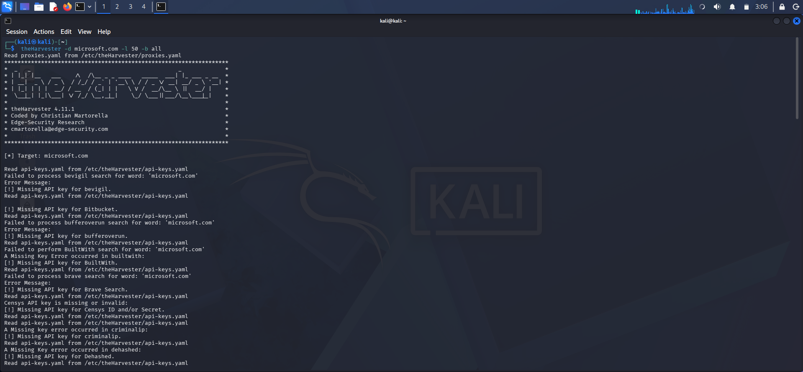

**Lesson learned:** theHarvester is much more useful when API keys are configured. Free sources alone return limited results.

---

## 7. W2-PM5: Network scanning with Zenmap

**Tool:** Zenmap (Nmap) on Windows

### Task 1: Download and install Zenmap

I installed Nmap and Zenmap from the official Nmap website. The installer finished successfully.

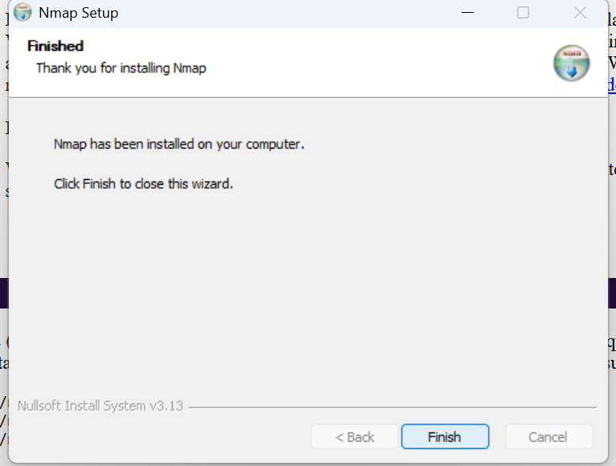

### Task 2: Local IP address and LAN subnet

Command: `ipconfig`

| Item | Value |
|---|---|
| IPv4 address | 192.168.56.1 |
| Subnet mask | 255.255.255.0 |
| Subnet to scan | 192.168.56.0/24 |

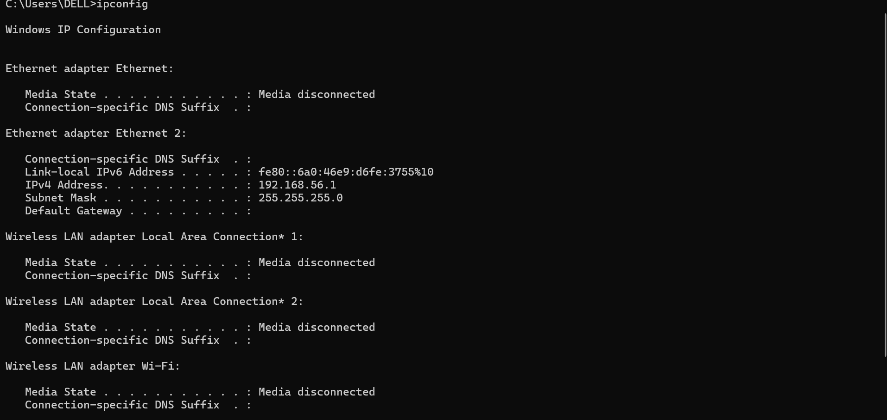

### Tasks 3 to 5: Live hosts

Zenmap profile: **Ping scan**
Command: `nmap -sn 192.168.56.0/24`

- 256 IP addresses were scanned in about 11.95 seconds.
- **Live hosts: 1**
- **IP address of the live host:** 192.168.56.1

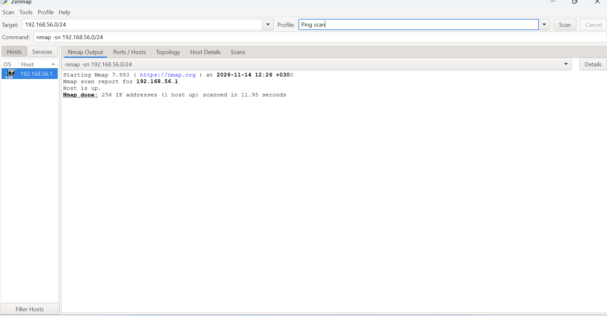

### Task 6: MAC addresses

The only live host is `192.168.56.1`, which is my own machine's **VirtualBox Host-Only Ethernet Adapter**. Nmap did not print a MAC address for it in the scan output, so I read it with `ipconfig /all`:

| Live host | Adapter | MAC address (Physical Address) |
|---|---|---|
| 192.168.56.1 | VirtualBox Host-Only Ethernet Adapter | **0A-00-27-00-00-0A** |

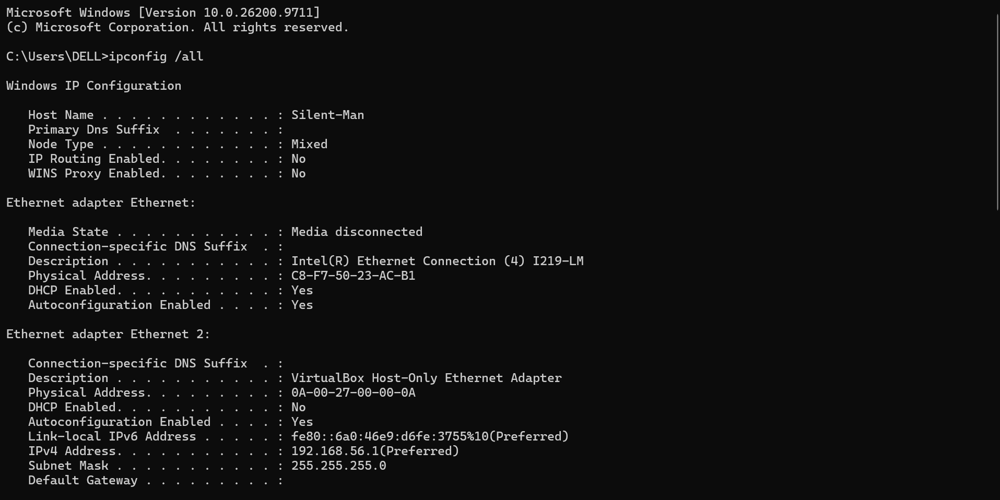

### Task 7: Topology PDF

I exported the topology from Zenmap's **Topology** tab using *Save Graphic* as a PDF: [5-zenmap-topology.pdf](PM5-zenmap/5-zenmap-topology.pdf).

The topology shows a single node, `192.168.56.1` (localhost). This matches the ping scan: the only live host in the subnet is my own machine, so there are no other devices to draw.

---

## 8. Overall findings and recommendations

**What footprinting revealed about `networkwalks.com` using only public information:**

- It is a WordPress site on Apache, hosted at `192.232.216.135`, with HostGator name servers and cPanel email.
- It is protected by a ModSecurity WAF, and the registrar lock is enabled.
- DNSSEC is not enabled.
- A public email address (`info@networkwalks.com`) is exposed.

**Suggestions for the site owner:**

1. Hide or reduce version information in HTTP headers and banners where possible.
2. Keep WordPress, its plugins and its themes updated, since the CMS is easy to identify.
3. Consider enabling DNSSEC.
4. Use a contact form instead of a plain email address to reduce phishing and spam.
5. Keep the WAF rules updated.

## 9. Conclusion

This week showed how much information can be collected without attacking a system: ownership, hosting, technology, DNS records and email addresses. It also showed the limits of the tools: results depend on the sources used, and some tools need API keys to give good results. Understanding what an attacker can learn this way helps defenders decide what to hide and what to protect.

## 10. Tools used

`whois`, `whatweb`, `nslookup`, `curl`, `wafw00f`, `dnsrecon`, Maltego 4.14.0, theHarvester 4.11.1, Zenmap / Nmap, `ipconfig`.

*Educational use only. Do not test any system without written permission.*
